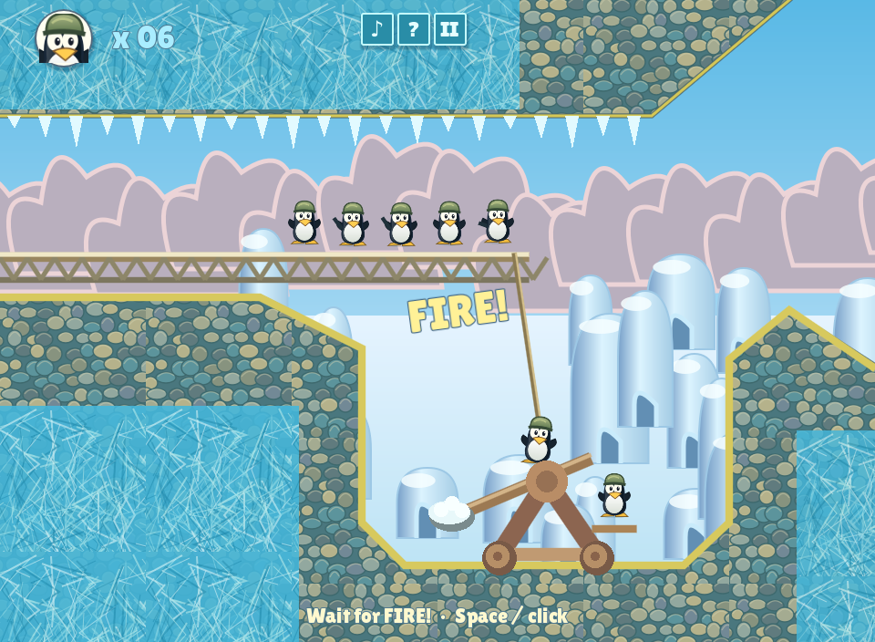
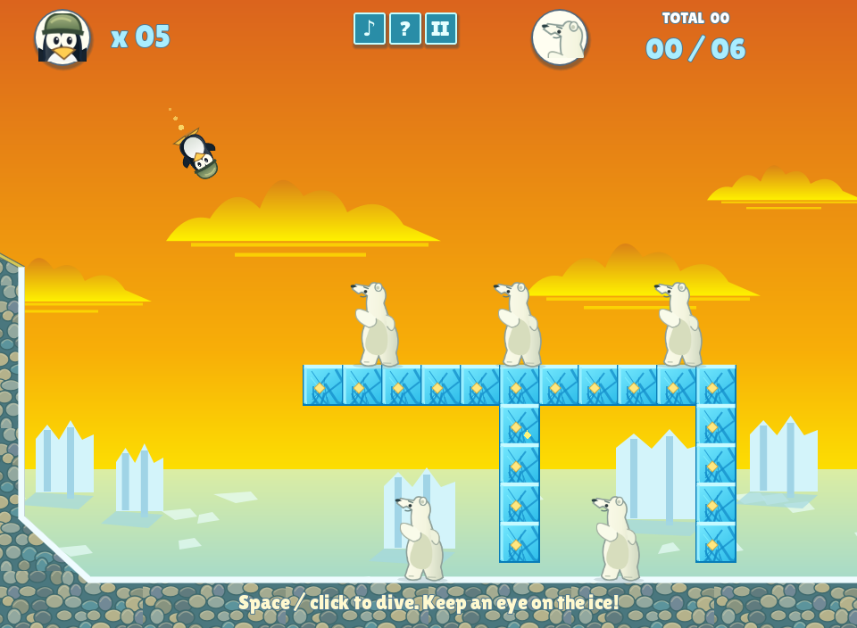

# Penguin Catapult — reference reconstruction, v0.2.0

A complete offline Windows mission in **Godot 4.6.3 stable**, GDScript and the Compatibility renderer. This revision rebuilds the UI, artwork direction and core loop using the gameplay video and APK supplied by the user. It adds rope-timed catapult launches, a compact icon HUD, an ice-framed mission briefing, sequential dives, breakable ice, rebounds, falling bears and a scrolling attack field.

[Download the current Windows ZIP](https://github.com/Piccol1001/ChatgptMusicHiFiPlayer/raw/refs/heads/main/penguin-catapult/downloads/Snowbound-Windows-x86_64.zip)





## Play on Windows — no editor installation needed

1. Download the ZIP above and **extract it**. Open the extracted `Snowbound` folder.
2. Double-click **Snowbound.exe**, then click **Start Mission 1**.
3. **Catapult:** a penguin swings down from the overhead bridge. Press **Space** or click the playfield when **FIRE!** appears. Press once per penguin. Early, late and unpressed attempts miss. There are six attempts.
4. Read the mission panel, then click **Continue**. Successful launches determine your attack team.
5. **Attack:** each penguin flies left to right. Press **Space** or click once to dive. Aim slightly before a bear: the penguin keeps moving forward. A hit can bounce into more bears; dives also break ice and unsupported bears can fall.
6. Hit **at least six bears** before the team is exhausted. The game waits for every remaining flight/dive and falling bear to settle before showing the result.
7. **Esc** or **II** pauses/resumes. Retry resets the team and all ice. The final Continue leads to the mission-complete screen; this build contains one mission.

The top-left counter shows unused penguins; the active flight is already deployed and is not included in that number. The top-right fraction shows bears hit / required hits. `TOTAL` is the current-mission hit count. Use **♪** to mute/unmute and **?** for controls. Close the window to quit.

The game runs without Internet, accounts or background services. Sound setting, completion and best score stay in `user://progress.cfg`, normally `%APPDATA%\Godot\app_userdata\Penguin Catapult — Snowbound\progress.cfg`. Existing local progress is preserved.

The Windows executable is unsigned. Windows export was checked in Linux; actual Windows execution, hardware audio and feel still need laptop testing. See [validation](VALIDATION.md). This is a one-mission reconstruction with original art, not a complete or pixel-identical port; see [observations and assumptions](REFERENCE.md).

## Open the Godot project

First [download the Godot source ZIP](https://github.com/Piccol1001/ChatgptMusicHiFiPlayer/raw/refs/heads/main/penguin-catapult/downloads/Snowbound-Godot-Source.zip) and extract it. The Windows play ZIP contains the packaged game; the source ZIP contains `project.godot` and editable files.

1. Download and extract the standard **Godot 4.6.3 stable** Windows x86_64 editor. The .NET version is unnecessary.
2. Run the editor. In Project Manager choose **Import**, select `project.godot` from this folder, then **Import & Edit**.
3. Wait for imports, then press **F5** to play. Close the game window to return to the editor.

There are no plugins or package installs. The logical viewport is **960×704**, adapting the supplied video's near-4:3 composition to a laptop. Wider windows use letterboxing. Physics runs at **120 fixed steps per second**.

## Files and tuning

| Location | Purpose |
| --- | --- |
| `scenes/main.tscn` | Main scene |
| `scripts/game.gd` | Explicit states, swing timing, flight/dive physics, swept collisions, bear/ice rules and outcomes |
| `levels/level_01.json` | Mission layout, quota, swing/dive timing, speeds, collision sizes and scoring |
| `scripts/world.gd` | Map, cavern, catapult, camera view and attack presentation |
| `scripts/hud.gd`, `scripts/menu_art.gd` | Icon HUD, menus, briefing, results and celebration |
| `scripts/art.gd`, `assets/` | Original replaceable vector art; bundled OFL fonts |
| `scripts/sound.gd`, `scripts/local_save.gd` | Original synthesized sounds and local persistence |
| `tools/make_art.py` | Deterministically regenerates original SVG artwork; standard Python only |
| `tests/` | Gameplay regression and real mouse-routing/rendering checks |

Edit the JSON numbers to tune the mission. Coordinates are logical pixels; bear positions are their feet. The original video's precise physics and every original collision rule are not claimed to be reproduced. No APK, original game code, extracted sprites or original audio is distributed here. Font and Godot license notices are in `licenses/`.

## Export again

In Godot, choose **Editor → Manage Export Templates → Download and Install** for 4.6.3. Then choose **Project → Export → Windows Desktop → Export Project**. Select `Snowbound.exe` as the output and turn off “Export With Debug”. The preset targets Windows x86_64 with embedded game data. Templates are not needed to run the supplied build.

## Cloud development and checks

Use the existing checkout; tasks are already isolated. Run `bash tools/setup-cloud.sh`, then `source /workspace/.penguin-tools/env.sh`. Prepared tooling and official checksum-verified templates are reused. No server or credentials are needed.

```sh
cd /workspace/ChatgptMusicHiFiPlayer/penguin-catapult
godot --headless --editor --import --quit
godot --headless --script tests/gameplay_test.gd
# With a graphical display:
godot --path .
# Optional rendered input checks, with DISPLAY set for your X11 session:
godot --audio-driver Dummy --resolution 960x704 --script tests/presentation_capture.gd
# Export and package:
mkdir -p builds/windows
godot --headless --export-release 'Windows Desktop' builds/windows/Snowbound.exe
python3 tools/package_release.py
```

The separate Android music-player application and its release/signing metadata are unchanged.
